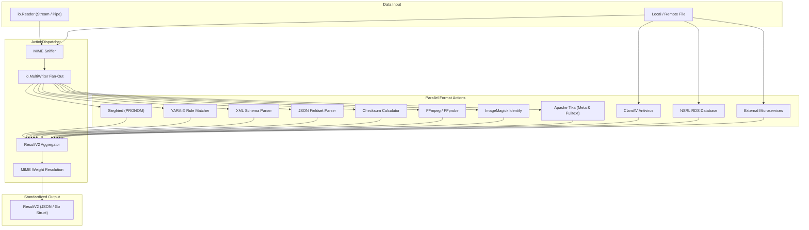

# indexer

[](https://goreportcard.com/report/github.com/ocfl-archive/indexer/v3)
[](LICENSE)

A high-performance file format identification, checksumming, and technical metadata extraction engine for digital archives, preservation repositories, and digital asset management pipelines.

Originally based on the concept of [dla-marbach/indexer](https://github.com/dla-marbach/indexer), the Go `indexer` accelerates file characterization by multiplexing data streams across multiple identification and extraction tools concurrently in a single pass.

---

## Key Features

- **Concurrent Streaming Pipeline**: Evaluates multiple identification actions simultaneously over an `io.Reader` using stream fan-out (`io.MultiWriter`), avoiding disk I/O bottlenecks.
- **PRONOM Identification**: Embedded and external [Siegfried](https://www.itforarchivists.com/siegfried) signature analysis for PRONOM PUIDs and standardized MIME types.
- **Rule-Based Classification & Pattern Matching**: Native in-process [YARA-X](https://virustotal.github.io/yara-x/) engine for complex signature detection, metadata extraction, and security heuristics.
- **Deep Schema Matching**: Streaming XML (METS, MEI, ALTO, ABBYY) and JSON (GeoJSON, npm package, JSON-LD) schema identification.
- **Multi-Digest Hashing**: Single-pass computation of SHA-512, SHA-256, MD5, SHA-3, and BLAKE2b checksums.
- **Multimedia & Graphic Inspection**: Integrates FFmpeg (`ffprobe`) for audio/video duration/codecs/dimensions and ImageMagick (`identify`) for image geometry, frames, and color profiles.
- **Text & Document Extraction**: Apache Tika integration for extracting metadata and full text from PDFs, Office formats, and ebooks.
- **Security & Forensics**: ClamAV antivirus scanning and NIST NSRL RDS hash lookups against BadgerDB.
- **Deterministic MIME Resolution**: Configurable priority weighting (`MimeRelevance`) to resolve format ambiguities.
- **Extensible Architecture**: Microservice and webhook integration via HTTP external actions (`[[Indexer.External]]`).

---

## Architecture Overview



---

## Action Matrix

| Action | Capability | Description | Documentation |
|---|---|---|---|
| `siegfried` | `ACTFILEHEAD`, `ACTSTREAM` | Signature-based PRONOM identification | [Siegfried Action](docs/actions/siegfried.md) |
| `yarax` | `ACTFILEHEAD`, `ACTSTREAM` | Rule-based pattern matching and format identification | [YARA-X Action](docs/actions/yarax.md) |
| `xml` | `ACTFILEHEAD`, `ACTSTREAM` | Fast streaming XML root tag & namespace matching | [XML Action](docs/actions/xml.md) |
| `json` | `ACTFILEHEAD`, `ACTSTREAM` | Streaming JSON fieldset & schema detection | [JSON Action](docs/actions/json.md) |
| `checksum` | `ACTSTREAM` | Concurrent multi-algorithm hash generation | [Checksum Action](docs/actions/checksum.md) |
| `ffprobe` | `ACTFILEHEAD`, `ACTSTREAM`, `ACTALLPROTO` | Audio & video duration, streams, and dimensions | [FFprobe Action](docs/actions/ffprobe.md) |
| `identify` | `ACTFILEHEAD`, `ACTSTREAM`, `ACTALLPROTO` | Image colorspace, geometry, and frame properties | [ImageMagick Action](docs/actions/identify.md) |
| `tika` | `ACTFILEHEAD`, `ACTSTREAM`, `ACTALLPROTO` | Document metadata and full-text extraction | [Apache Tika Action](docs/actions/tika.md) |
| `clamav` | `ACTFILEFULL` | ClamAV antivirus / malware scanning | [ClamAV Action](docs/actions/clamav.md) |
| `nsrl` | `ACTFILE` | NIST NSRL RDS hash verification via BadgerDB | [NSRL Action](docs/actions/nsrl.md) |
| `External` | Configurable | Custom external REST microservices & webhooks | [External Actions](docs/actions/external.md) |

---

## Quick Start

### 1. Installation

```bash
# Clone the repository
git clone https://github.com/ocfl-archive/indexer.git
cd indexer

# Build the CLI utility
go build -o identify ./cmd/identify
```

### 2. Run Format Identification

```bash
# Run identification on a file using standard configuration
./identify -cfg configs/indexer.toml -in sample.pdf
```

### 3. Example Output

```json
{
  "mimetype": "application/pdf",
  "mimetypes": [
    "application/pdf"
  ],
  "pronom": "fmt/18",
  "pronoms": [
    "fmt/18"
  ],
  "size": 154289,
  "type": "document",
  "subtype": "pdf",
  "checksum": {
    "md5": "c80ec5bf08d51ec73f71c4c9fa38290e",
    "sha256": "5c9b68ef2ea8380cfd6874dc6182bfdbad492d3f742c8d2345ef27b231ff6f8a"
  },
  "metadata": {
    "siegfried": [
      {
        "ns": "pronom",
        "id": "fmt/18",
        "format": "Acrobat PDF 1.4 - Portable Document Format",
        "mime": "application/pdf",
        "basis": ["byte match at 0, 48"]
      }
    ]
  }
}
```

---

## Documentation

Comprehensive documentation is available in the [`docs/`](docs/) directory:

- **[Documentation Hub](docs/README.md)**: Main documentation index.
- **[Architecture & Design](docs/architecture.md)**: Details on the streaming fan-out engine, `ActionDispatcher`, MIME relevance, and `ResultV2`.
- **[Configuration Reference](docs/configuration.md)**: Complete guide to all `indexer.toml` configuration options.
- **[CLI Guide](docs/cli.md)**: Usage guide for `identify`, `nsrl2badger`, and `test` utilities.
- **[Go API Guide](docs/api.md)**: Guide on embedding `indexer` in Go applications and implementing custom actions.
- **Individual Action Documentation**:
  - [Siegfried Action](docs/actions/siegfried.md)
  - [XML Action](docs/actions/xml.md)
  - [JSON Action](docs/actions/json.md)
  - [Checksum Action](docs/actions/checksum.md)
  - [FFprobe Action](docs/actions/ffprobe.md)
  - [ImageMagick Identify Action](docs/actions/identify.md)
  - [Apache Tika Action](docs/actions/tika.md)
  - [ClamAV Action](docs/actions/clamav.md)
  - [NSRL Action](docs/actions/nsrl.md)
  - [External Actions](docs/actions/external.md)

---

## Go Library Usage

```go
package main

import (
	"context"
	"fmt"
	"log"
	"os"

	"github.com/je4/utils/v2/pkg/zLogger"
	"github.com/ocfl-archive/indexer/v3/pkg/indexer"
	"github.com/ocfl-archive/indexer/v3/pkg/util"
	"github.com/rs/zerolog"
)

func main() {
	zl := zerolog.New(os.Stdout).With().Timestamp().Logger()
	var logger zLogger.ZLogger = &zl

	cfg := &indexer.IndexerConfig{
		Siegfried: indexer.ConfigSiegfried{Enabled: true},
		Checksum:  indexer.ConfigChecksum{Enabled: true, Digest: []string{"sha256"}},
		XML:       indexer.ConfigXML{Enabled: true},
	}

	idx, actions, closer, err := util.InitIndexer(cfg, logger)
	if err != nil {
		log.Fatal(err)
	}
	defer closer.Close()

	file, err := os.Open("sample.xml")
	if err != nil {
		log.Fatal(err)
	}
	defer file.Close()

	result, err := idx.ActionDispatcher().StreamContext(
		context.Background(),
		file,
		[]string{"sample.xml"},
		actions,
	)
	if err != nil {
		log.Fatal(err)
	}

	fmt.Printf("MIME: %s | PRONOM: %s\n", result.Mimetype, result.Pronom)
}
```

---

## Rights & License

Copyright 2020-2024 Jürgen Enge, info-age GmbH, Basel.

Licensed under the [Apache License, Version 2.0](http://www.apache.org/licenses/LICENSE-2.0).
