# Indexer Documentation

Welcome to the `indexer` technical documentation.

---

## Documentation Index

```mermaid
graph TD
    Root["Documentation Hub"] --> Gen["General Guides"]
    Root --> Actions["Action Reference"]

    Gen --> Arch["Architecture & Pipeline (architecture.md)"]
    Gen --> Cfg["Configuration Reference (configuration.md)"]
    Gen --> CLI["Command Line Tools (cli.md)"]
    Gen --> API["Go API & Library Guide (api.md)"]

    Actions --> SF["Siegfried (actions/siegfried.md)"]
    Actions --> XML["XML Format (actions/xml.md)"]
    Actions --> JSON["JSON Schemas (actions/json.md)"]
    Actions --> CS["Checksum (actions/checksum.md)"]
    Actions --> FF["FFmpeg / FFprobe (actions/ffprobe.md)"]
    Actions --> IM["ImageMagick (actions/identify.md)"]
    Actions --> TK["Apache Tika (actions/tika.md)"]
    Actions --> AV["ClamAV (actions/clamav.md)"]
    Actions --> NSRL["NSRL RDS (actions/nsrl.md)"]
    Actions --> EXT["External Services (actions/external.md)"]
```

---

## General Documentation

- **[Architecture & Design](architecture.md)**: Details the streaming fan-out model, `ActionDispatcher` lifecycle, MIME weighting resolution, and `ResultV2` structure.
- **[Configuration Reference](configuration.md)**: Full reference for `indexer.toml`, MIME relevance definitions, formats, and action blocks.
- **[CLI Guide](cli.md)**: Guide for command-line tools: `identify`, `nsrl2badger`, and `test`.
- **[Go API & Library Guide](api.md)**: How to integrate `indexer` into Go applications and implement custom `Action` extensions.

---

## Action Reference

| Action | Documentation | Key Functionality | Capabilities |
|---|---|---|---|
| `siegfried` | [Siegfried Action](actions/siegfried.md) | PRONOM PUID & signature-based format identification | `ACTFILEHEAD`, `ACTSTREAM` |
| `xml` | [XML Action](actions/xml.md) | Streaming XML root & namespace matching (METS, MEI, FineReader) | `ACTFILEHEAD`, `ACTSTREAM` |
| `json` | [JSON Action](actions/json.md) | Streaming JSON fieldset matching (GeoJSON, npm, etc.) | `ACTFILEHEAD`, `ACTSTREAM` |
| `checksum` | [Checksum Action](actions/checksum.md) | Single-pass multi-algorithm hashing (SHA512, SHA256, MD5) | `ACTSTREAM` |
| `ffprobe` | [FFprobe Action](actions/ffprobe.md) | Audio/video metadata & stream geometry analysis | `ACTFILEHEAD`, `ACTSTREAM`, `ACTALLPROTO` |
| `identify` | [ImageMagick Action](actions/identify.md) | Image metadata, colorspace, geometry, and frame analysis | `ACTFILEHEAD`, `ACTSTREAM`, `ACTALLPROTO` |
| `tika` / `fulltext` | [Apache Tika Action](actions/tika.md) | Document metadata and full-text extraction via Tika Server | `ACTFILEHEAD`, `ACTSTREAM`, `ACTALLPROTO` |
| `clamav` | [ClamAV Action](actions/clamav.md) | Antivirus and malware scanning | `ACTFILEFULL` |
| `nsrl` | [NSRL Action](actions/nsrl.md) | NIST Reference Data Set hash matching via BadgerDB | `ACTFILE` |
| `External` | [External Actions](actions/external.md) | Custom REST microservices / webhooks integration | Configurable (`ACTFILE`, `ACTHTTP`, `ACTSTREAM`) |
