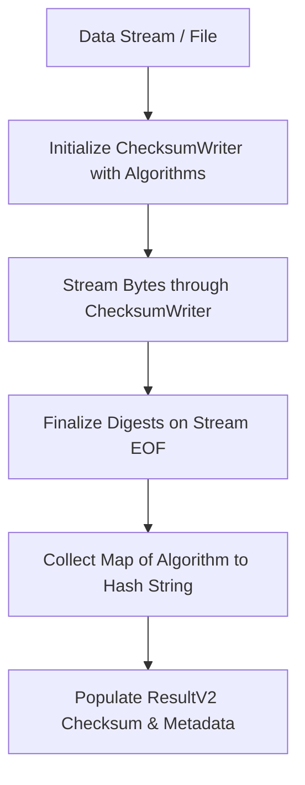

# Checksum Action (`checksum`)

The `checksum` action calculates cryptographic message digests (hashes) in a single streaming pass as data moves through the indexer pipeline.

---

## Overview

Calculating cryptographic hashes is fundamental to digital preservation, integrity verification, and deduplication. The `checksum` action integrates `github.com/je4/utils/v2/pkg/checksum` to compute one or multiple checksum algorithms concurrently without disk rewrites.

### Key Capabilities
- **Capability Flags**: `ACTSTREAM`
- **Supported Hash Algorithms**: `md5`, `sha1`, `sha256`, `sha512`, `sha3-256`, `sha3-512`, `blake2b-256`, `blake2b-512`
- **Single Pass**: Evaluates all configured digests simultaneously via a multi-checksum writer.
- **Default Priority Weight**: `10`

---

## Execution Flow



---

## Configuration

In `indexer.toml`, configure the `[Indexer.Checksum]` section:

```toml
[Indexer.Checksum]
enabled = true
digest = ["sha512", "sha256", "md5"]
```

### Configuration Fields

| Parameter | Type | Default | Description |
|---|---|---|---|
| `enabled` | `bool` | `true` | Enables or disables checksum generation. |
| `digest` | `[]checksum.DigestAlgorithm` | `[]` | Array of digest algorithm names (e.g. `["sha512", "sha256", "md5"]`). |

---

## Output Structure

The action populates:

- `Checksum`: Map where keys are algorithm names (e.g., `"sha512"`, `"sha256"`, `"md5"`) and values are lowercase hex digest strings.
- `Metadata["checksum"]`: Map containing the exact algorithm-to-hash mapping.

### Example JSON Result

```json
{
  "checksum": {
    "md5": "098f6bcd4621d373cade4e832627b4f6",
    "sha256": "9f86d081884c7d659a2feaa0c55ad015a3bf4f1b2b0b822cd15d6c15b0f00a08",
    "sha512": "ee26b0dd4af7e749aa1a8ee3c10ae9923f618980772e473f8819a5d4940e0db27ac185f8a0e1d5f84f88bc887fd67b143732c304cc5fa9ad8e6f57f50028a8ff"
  }
}
```
