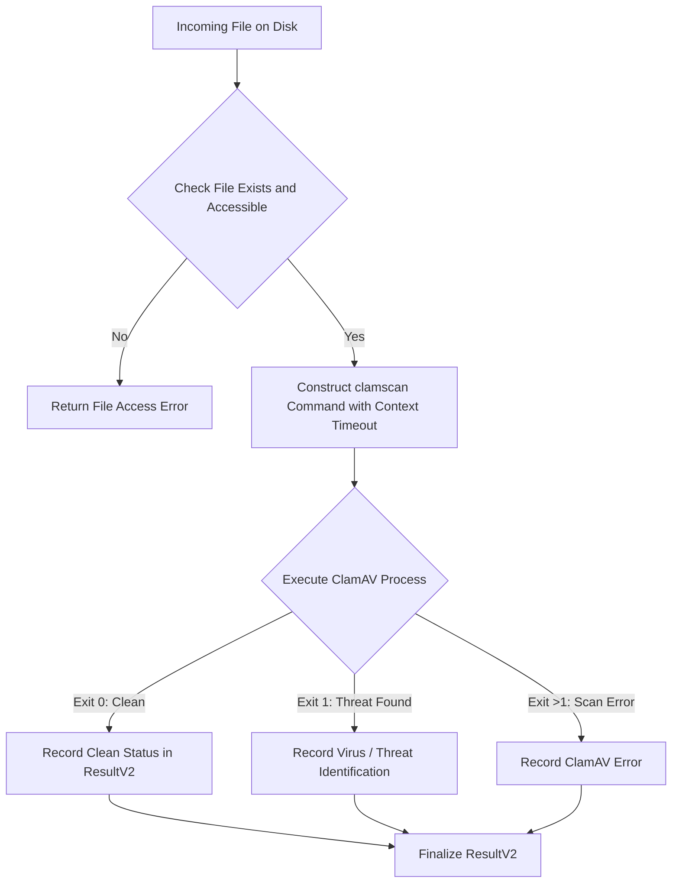

# ClamAV Action (`clamav`)

The `clamav` action performs antivirus scanning and malware detection on ingested files using the open-source ClamAV suite (`clamscan` / `clamdscan`).

---

## Overview

Security screening ensures digital assets are free from known malicious payloads, macros, viruses, and embedded threats prior to preservation. The `clamav` action invokes ClamAV to verify file safety.

### Key Capabilities
- **Capability Flags**: `ACTFILEFULL` (`ACTFILE & ^ACTHEAD` - requires full local file on disk)
- **WSL Support**: Supports Windows host execution forwarding to Linux ClamAV daemons via WSL.
- **Configurable Timeout**: Context-aware process lifecycle termination.
- **Default Priority Weight**: `100`

---

## Execution Flow



---

## Configuration

In `indexer.toml`, configure the `[Indexer.clamav]` section:

```toml
[Indexer.clamav]
enabled = true
clamscan = "/usr/bin/clamdscan" # Path to clamscan or clamdscan
wsl = false                    # Set true if clamscan runs in WSL
timeout = "15s"                # Maximum scan duration
```

### Configuration Fields

| Parameter | Type | Default | Description |
|---|---|---|---|
| `enabled` | `bool` | `true` | Enables or disables antivirus scanning. |
| `clamscan` | `string` | `"/usr/bin/clamdscan"` | Path to the ClamAV scanning binary (e.g., `clamscan` or daemon client `clamdscan`). |
| `wsl` | `bool` | `false` | When `true`, executes ClamAV through `wsl.exe` on Windows hosts. |
| `timeout` | `config.Duration` | `"15s"` | Scan timeout duration. |

---

## Output Structure

The action populates `ResultV2`:

- `Errors["clamav"]`: Populated with threat details if infected, or execution error if scanning fails.
- `Metadata["clamav"]`: Scan summary and verification status.
