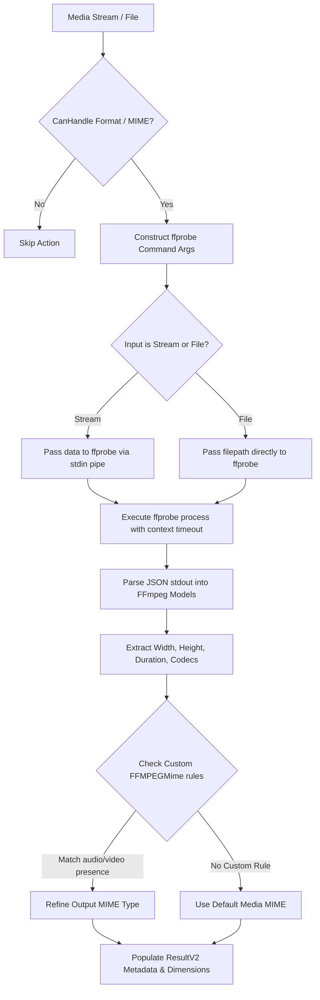

# FFprobe Action (`ffprobe`)

The `ffprobe` action extracts rich technical metadata (dimensions, duration, codecs, bitrates, audio channels, fps) from audio and video streams and files using FFmpeg's `ffprobe` utility.

---

## Overview

Multimedia files require detailed container and stream level inspection. The `ffprobe` action invokes `ffprobe -show_format -show_streams -print_format json` directly or over standard input pipes (or via WSL on Windows hosts when configured).

### Key Capabilities
- **Capability Flags**: `ACTFILEHEAD | ACTSTREAM` (and `ACTALLPROTO` when `online` mode is active)
- **Supported Formats**: Comprehensive video and audio containers (`.mp4`, `.mov`, `.mkv`, `.avi`, `.flac`, `.mp3`, `.wav`, `.ogg`, `.webm`, `.m4a`, `.mxf`, etc.).
- **WSL Interoperability**: Seamlessly invokes `wsl.exe ffprobe` when running on Windows with Linux-installed toolchains.
- **Duration & Geometry Extraction**: Automatically parses format duration to seconds and identifies highest video stream dimensions (`Width` x `Height`).
- **Default Priority Weight**: `50`

---

## Execution Flow



---

## Configuration

In `indexer.toml`, configure the `[Indexer.FFMPEG]` section:

```toml
[Indexer.FFMPEG]
enabled = true
ffprobe = "ffprobe" # Path to ffprobe binary (or "wsl ffprobe")
wsl = false          # Set to true if executable runs inside WSL
timeout = "25s"      # Subprocess execution timeout
online = true        # Allow remote URL streams

[[Indexer.FFMPEG.Mime]]
video = false
audio = true
format = "mov,mp4,m4a,3gp,3g2,mj2"
mime = "audio/mp4"

[[Indexer.FFMPEG.Mime]]
video = true
audio = true
format = "mov,mp4,m4a,3gp,3g2,mj2"
mime = "video/mp4"

[[Indexer.FFMPEG.Mime]]
video = true
audio = false
format = "mov,mp4,m4a,3gp,3g2,mj2"
mime = "video/mp4"
```

### Configuration Fields

| Parameter | Type | Default | Description |
|---|---|---|---|
| `enabled` | `bool` | `true` | Enables or disables FFprobe analysis. |
| `ffprobe` | `string` | `"ffprobe"` | Path or executable name for `ffprobe`. |
| `wsl` | `bool` | `false` | When `true`, executes the command via WSL on Windows. |
| `timeout` | `config.Duration` | `"15s"` | Maximum execution time per invocation. |
| `online` | `bool` | `false` | Enables processing of online/remote HTTP/HTTPS media sources. |
| `mime` | `[]FFMPEGMime` | `[]` | Custom MIME mapping rules conditioned on video/audio stream presence and container format name. |

---

## Output Structure

The action populates `ResultV2`:

- `Width`: Width in pixels of primary video stream.
- `Height`: Height in pixels of primary video stream.
- `Duration`: Total media duration in integer seconds.
- `Mimetype` / `Mimetypes`: Appended with refined media MIME type.
- `Metadata["ffprobe"]`: Contains full format and stream objects from FFprobe (`ffmpeg_models.Metadata`).
