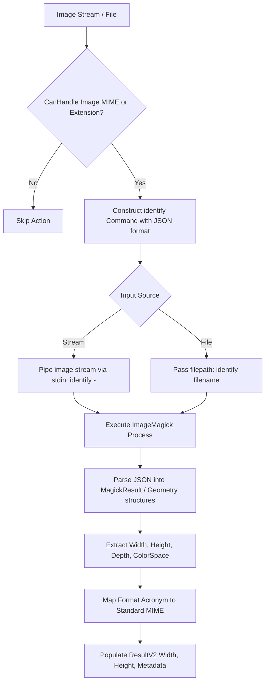

# ImageMagick Action (`identify`)

The `identify` action validates image files, identifies specific graphic formats, and extracts technical properties (dimensions, colorspace, format profiles, and multi-frame geometries) using ImageMagick's `identify` and `convert` tools.

---

## Overview

ImageMagick provides deep raster and vector graphic inspection. The `identify` action (implemented in `ActionIdentifyV2`) parses ImageMagick's JSON output to extract precise geometry, canvas offsets, color depths, compression types, and embedded profiles across single and multi-page images (e.g. TIFF, GIF animations, PDF frames).

### Key Capabilities
- **Capability Flags**: `ACTFILEHEAD | ACTSTREAM` (and `ACTALLPROTO` in `online` mode)
- **JSON Metadata Parsing**: Reads ImageMagick structured `-format "%[json:]"` output into `MagickResult` models.
- **Embedded MIME DB**: Matches MIME types and acronym extensions via embedded ImageMagick `mime.xml` data.
- **Multi-Frame Analysis**: Extracts individual frame dimensions and page count for multi-layer/multi-page files.
- **Default Priority Weight**: `50`

---

## Execution Flow



---

## Configuration

In `indexer.toml`, configure the `[Indexer.ImageMagick]` section:

```toml
[Indexer.ImageMagick]
enabled = true
identify = "identify" # Path to identify executable (or magick identify)
convert = "convert"   # Path to convert executable
wsl = false           # Set to true if executable runs inside WSL
timeout = "480s"      # Subprocess timeout
online = true         # Allow remote URL image sources
```

### Configuration Fields

| Parameter | Type | Default | Description |
|---|---|---|---|
| `enabled` | `bool` | `true` | Enables or disables ImageMagick analysis. |
| `identify` | `string` | `"identify"` | Path or executable command for `identify`. |
| `convert` | `string` | `"convert"` | Path or executable command for `convert`. |
| `wsl` | `bool` | `false` | When `true`, executes ImageMagick tools via WSL on Windows. |
| `timeout` | `config.Duration` | `"480s"` | Maximum execution time allowed for processing an image. |
| `online` | `bool` | `false` | Enables processing of online/remote HTTP/HTTPS image sources. |

---

## Output Structure

The action populates `ResultV2`:

- `Width`: Primary width in pixels of image (or first/largest frame).
- `Height`: Primary height in pixels of image (or first/largest frame).
- `Mimetype` / `Mimetypes`: Appended with detected graphic MIME type.
- `Metadata["identify"]`: Stores `FullMagickResult` containing:
  - `magick`: Top-level ImageMagick metadata (colorspace, compression, resolution, profiles).
  - `frames`: Array of per-frame `Geometry` objects (width, height, page offsets) for multi-frame images.
