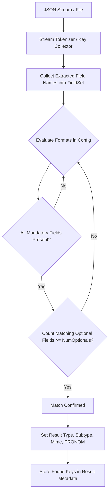

# JSON Action (`json`)

The `json` action identifies specific JSON schemas and structure profiles (such as GeoJSON, JSON-LD, OpenAPI, npm `package.json`, etc.) using efficient streaming token parsing.

---

## Overview

JSON files are often categorized generically as `application/json` or `text/plain`. The `json` action inspects JSON keys and fields in a stream or file to determine specific subtypes and PRONOM IDs based on combinations of **mandatory** and **optional** field requirements.

### Key Capabilities
- **Capability Flags**: `ACTFILEHEAD | ACTSTREAM`
- **Streaming Parser**: Scans JSON tokens using `encoding/json/v2` with `ExtractJSONFieldSet` to collect key names across nesting levels.
- **Rule Flexibility**: Matches formats based on all mandatory keys and at least *N* optional keys.
- **Default Priority Weight**: `10`

---

## Execution Flow



---

## Configuration

In `indexer.toml`, configure the `[Indexer.JSON]` section:

```toml
[Indexer.JSON]
enabled = true

[Indexer.JSON.Format.geojson]
mandatoryfields = ["type", "features"]
optionalfields = ["bbox", "crs"]
numoptionals = 0
pronom = "fmt/817"
mime = "application/geo+json"
type = "vector"
subtype = "geojson"

[Indexer.JSON.Format.packagejson]
mandatoryfields = ["name", "version"]
optionalfields = ["description", "dependencies", "devDependencies", "scripts", "main"]
numoptionals = 1
pronom = "fmt/1001"
mime = "application/json"
type = "metadata"
subtype = "npm-package"
```

### Configuration Fields

| Parameter | Type | Default | Description |
|---|---|---|---|
| `Enabled` | `bool` | `true` | Enables or disables JSON schema inspection. |
| `Format.<Name>.MandatoryFields` | `[]string` | `[]` | List of JSON field names that **must all** be present. |
| `Format.<Name>.OptionalFields` | `[]string` | `[]` | List of candidate field names checked for matching. |
| `Format.<Name>.NumOptionals` | `int` | `0` | Minimum count of optional fields required to trigger a match. |
| `Format.<Name>.Type` | `string` | `""` | Primary category type. |
| `Format.<Name>.Subtype` | `string` | `""` | Specific format subtype. |
| `Format.<Name>.Mime` | `string` | `""` | Associated MIME type. |
| `Format.<Name>.Pronom` | `string` | `""` | PRONOM PUID assigned upon match. |

---

## Output Structure

The action populates `ResultV2`:

- `Type`: Extracted type (e.g. `vector`, `metadata`).
- `Subtype`: Extracted subtype (e.g. `geojson`, `npm-package`).
- `Mimetype` / `Mimetypes`: Appended with the matched format's MIME type.
- `Pronom` / `Pronoms`: Appended with the matched PRONOM ID.
- `Metadata["json"]`: Contains the list of matching keys and detected schema format name.
