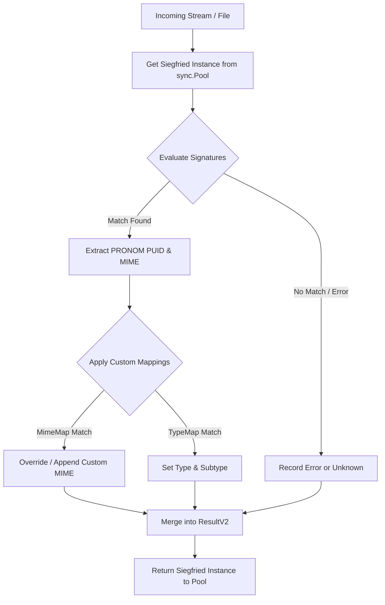

# Siegfried Action (`siegfried`)

The `siegfried` action performs signature-based file format identification using the [Siegfried](https://www.itforarchivists.com/siegfried) signature engine and the PRONOM technical registry.

---

## Overview

Siegfried is the primary format identifier in the indexer pipeline. It identifies file formats by analyzing byte signatures, file extensions, and container structures, providing standardized PRONOM identifiers (PUIDs) and MIME types.

### Key Capabilities
- **Capability Flags**: `ACTFILEHEAD | ACTSTREAM`
- **Streaming Support**: Yes (streams into memory up to `streamsize`, spills to temporary storage if larger)
- **Pool Management**: Uses a thread-safe `sync.Pool` of Siegfried signature evaluators for concurrent processing.
- **Default Priority Weight**: `10`

---

## Execution Flow



---

## Configuration

In `indexer.toml`, configure the `[Indexer.Siegfried]` section:

```toml
[Indexer.Siegfried]
enabled = true
signature = "" # Path to signature file, or "internal" / "" to use embedded signature
streamsize = 67108864 # Max bytes to buffer in memory before temp file (default 64MB)

[Indexer.Siegfried.MimeMap]
"fmt/134" = "audio/mp3"
"fmt/436" = "image/x-adobe-dng"
"x-fmt/92" = "image/psd"

[Indexer.Siegfried.TypeMap."fmt/483"]
Type = "text"
Subtype = "epub"
```

### Configuration Fields

| Parameter | Type | Default | Description |
|---|---|---|---|
| `enabled` | `bool` | `true` | Enables or disables Siegfried action execution. |
| `signature` | `string` | `""` | Path to `.sig` file, or empty/`internal` for embedded `default.sig`. Supports `fsys:path` syntax. |
| `streamsize` | `int` | `67108864` (64MB) | Max memory buffer size in bytes for streaming identification. |
| `mimemap` | `map[string]string` | `{}` | Maps PRONOM PUIDs (e.g. `fmt/134`) to preferred MIME types. |
| `typemap` | `map[string]TypeSubtype` | `{}` | Maps PRONOM PUIDs to primary `Type` and `Subtype` category strings. |

---

## Output Structure

The action populates the following fields in `ResultV2`:

- `Mimetypes`: Appended with identified MIME types from Siegfried and configured `MimeMap`.
- `Pronoms`: Appended with detected PRONOM identifiers (e.g., `fmt/40`, `x-fmt/111`).
- `Type` / `Subtype`: Set if mapped in `TypeMap`.
- `Metadata["siegfried"]`: Contains the raw identification objects from the Siegfried engine.

---

## Performance & Optimization Notes

1. **Concurrency**: Siegfried instances are pooled with `sync.Pool` to avoid reallocation overhead across goroutines.
2. **Memory Buffer**: For high-throughput streaming workloads, adjust `streamsize` according to memory constraints and typical file sizes.
