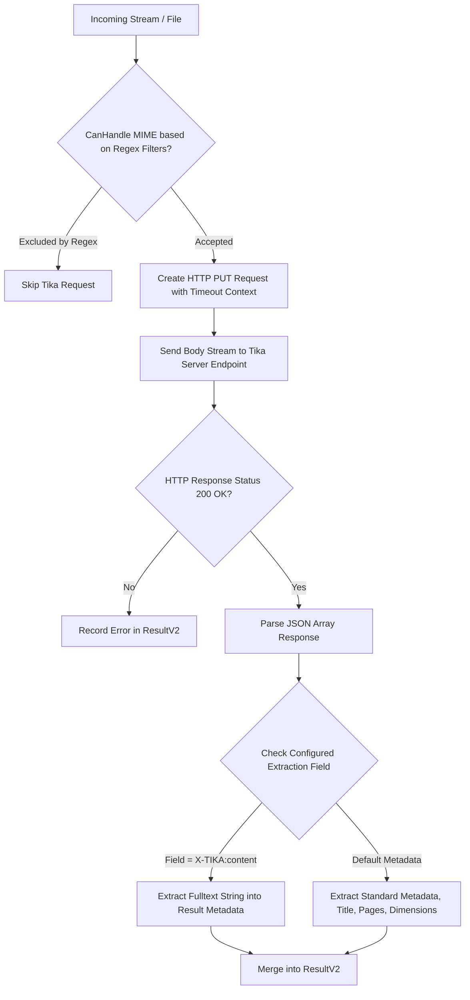

# Apache Tika Action (`tika` & `fulltext`)

The `tika` and `fulltext` actions communicate with an external [Apache Tika Server](https://tika.apache.org/) instance over HTTP REST API to extract rich document metadata and full-text content from Office documents, PDFs, eBooks, and hundreds of textual formats.

---

## Overview

Apache Tika analyzes complex container formats and textual artifacts. In the indexer engine, Tika functionality is split into two complementary actions registered via `ConfigTika`:
- **`tika` (`NameTika`)**: Performs recursive metadata extraction (`/rmeta/text` endpoint) to obtain author, creation dates, page counts, titles, and underlying formats.
- **`fulltext` (`NameFullText`)**: Extracts the textual contents (`X-TIKA:content`) for indexing and search purposes.

### Key Capabilities
- **Capability Flags**: `ACTFILEHEAD | ACTSTREAM` (and `ACTALLPROTO` in `online` mode)
- **MIME Filtering**: Configurable include (`regexpmime`) and exclude (`regexpmimenot`) regular expressions prevent sending incompatible binary streams (e.g., raw video or audio).
- **HTTP PUT Streaming**: Streams the payload directly to the Tika server endpoint with `Accept: application/json` headers.
- **Default Priority Weight**: `50`

---

## Execution Flow



---

## Configuration

In `indexer.toml`, configure the `[Indexer.Tika]` section:

```toml
[Indexer.Tika]
enabled = true
online = true
timeout = "15s"
addressmeta = "http://localhost:9998/rmeta/text"
addressfulltext = "http://localhost:9998/tika"
regexpmimemeta = "^."
regexpmimemetanot = "^(audio|video|image)/"
regexpmimefulltext = "^(application/pdf|application/msword|text/)"
regexpmimefulltextnot = "^(audio|video|image)/"
```

### Configuration Fields

| Parameter | Type | Default | Description |
|---|---|---|---|
| `enabled` | `bool` | `true` | Enables or disables Apache Tika integration. |
| `online` | `bool` | `false` | Enables processing of online/remote HTTP sources. |
| `timeout` | `config.Duration` | `"10s"` | HTTP client request timeout. |
| `addressmeta` | `string` | `""` | Tika server URL for recursive metadata extraction (e.g. `http://localhost:9998/rmeta/text`). |
| `addressfulltext` | `string` | `""` | Tika server URL for plain text content extraction. |
| `regexpmimemeta` | `string` | `""` | Regular expression of MIME types to process for metadata. |
| `regexpmimemetanot`| `string` | `""` | Regular expression of MIME types to exclude from metadata extraction. |
| `regexpmimefulltext` | `string` | `""` | Regular expression of MIME types to process for fulltext. |
| `regexpmimefulltextnot` | `string` | `""` | Regular expression of MIME types to exclude from fulltext extraction. |

---

## Running Apache Tika Server

To run Apache Tika Server locally with required endpoints:

```bash
# Run standalone Tika server jar
java -jar tika-server-standard-2.9.2.jar --port=9998

# Or via Docker
docker run -d -p 9998:9998 apache/tika:latest
```

---

## Output Structure

The actions populate `ResultV2`:

- `Metadata["tika"]`: Key-value map of document properties (e.g. `dc:creator`, `pdf:PDFVersion`, `meta:page-count`, `dcterms:created`).
- `Metadata["fulltext"]`: String containing extracted plain text from `X-TIKA:content`.
- `Width` / `Height`: Extracted if document contains explicit page dimensions (e.g. image/page sizes in points/pixels).
