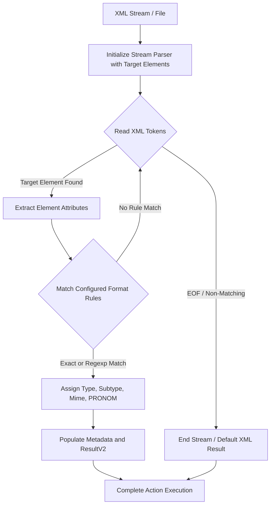

# XML Action (`xml`)

The `xml` action identifies specific XML schema formats and document profiles through high-speed streaming attribute and root element inspection without loading the entire XML document into memory.

---

## Overview

Many digital archive formats are XML-based (e.g., METS, ALTO, ABBYY FineReader, MEI, EAD, MARCXML). While generic identification tools identify them as `application/xml`, the `xml` action detects the domain-specific format, extracts relevant attributes (such as XML namespaces), and classifies the document type, subtype, and PRONOM ID.

### Key Capabilities
- **Capability Flags**: `ACTFILEHEAD | ACTSTREAM`
- **Streaming Parser**: Powered by `github.com/tamerh/xml-stream-parser`, inspecting only relevant element tags and attribute declarations.
- **Regex Support**: Allows regular expression matching on attribute values (e.g., matching URL variations of namespace declarations).
- **Default Priority Weight**: `10`

---

## Execution Flow



---

## Configuration

In `indexer.toml`, configure the `[Indexer.XML]` section and define specific formats under `[Indexer.XML.Format.<Name>]`:

```toml
[Indexer.XML]
enabled = true

[Indexer.XML.Format.FineReader10]
Element = "document"
Attributes.xmlns = "http://www.abbyy.com/FineReader_xml/FineReader10-schema-v1.xml"
Type = "ocr"
Subtype = "FineReader10"
Mime = "application/xml"
Pronom = "fmt/1000"

[Indexer.XML.Format.mets]
Element = "mets:mets"
Regexp = true
Attributes."xmlns:mets" = "^https?://www.loc.gov/METS/?$"
Type = "metadata"
Subtype = "METS"
Mime = "application/xml"
Pronom = "fmt/917"

[Indexer.XML.Format.mei]
Element = "mei"
Attributes.xmlns = "http://www.music-encoding.org/ns/mei"
Type = "audio"
Subtype = "mei"
Mime = "application/xml"
```

### Configuration Fields

| Parameter | Type | Default | Description |
|---|---|---|---|
| `Enabled` | `bool` | `true` | Enables or disables XML format inspection. |
| `Format.<Name>.Element` | `string` | *(key name)* | Name of the XML root or target tag to match (e.g. `document`, `mets:mets`). |
| `Format.<Name>.Attributes` | `map[string]string` | `{}` | Attribute key-value pairs required for a positive match. |
| `Format.<Name>.Regexp` | `bool` | `false` | When `true`, attribute values in configuration are evaluated as regular expressions. |
| `Format.<Name>.Type` | `string` | `""` | Primary category type (e.g., `metadata`, `ocr`, `audio`). |
| `Format.<Name>.Subtype` | `string` | `""` | Specific subtype or format name. |
| `Format.<Name>.Mime` | `string` | `""` | Associated MIME type (e.g., `application/xml` or specialized subtype). |
| `Format.<Name>.Pronom` | `string` | `""` | Optional PRONOM identifier assigned upon match. |

---

## Output Structure

The action populates:

- `Type`: Assigned document type.
- `Subtype`: Assigned document subtype.
- `Mimetype` / `Mimetypes`: Appended with specified MIME type.
- `Pronom` / `Pronoms`: Appended with specified PRONOM identifier if defined.
- `Metadata["xml"]`: Map containing `"element"` and `"attribute"` that triggered the match.
