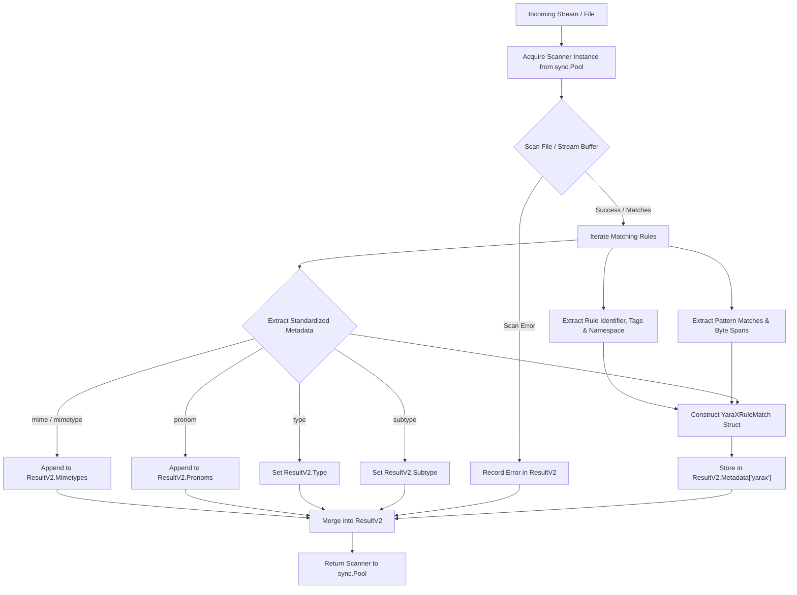

# YARA-X Action (`yarax`)

The `yarax` action executes rule-based file classification, format identification, and pattern matching using the native, in-process [YARA-X](https://virustotal.github.io/yara-x/) engine.

---

## Overview

YARA-X is a modern rewrite of the YARA pattern matching tool written in Rust, offering high-throughput, memory-safe in-process scanning. Within the `indexer` pipeline, the `yarax` action evaluates incoming byte streams or disk files against custom or community YARA-X rule sets to extract technical metadata, identify proprietary or esoteric file formats, and detect security-relevant byte patterns.

### Key Capabilities
- **Capability Flags**: `ACTFILEHEAD | ACTSTREAM`
- **Streaming Support**: Yes (streams into memory buffers for direct in-process evaluation)
- **Rule Flexibility**: Supports raw rule source files (`.yar`, `.yara`), precompiled binary rules (`.yrc`), and directory glob patterns.
- **Metadata Mapping**: Automatically populates `ResultV2` format fields (`Mimetypes`, `Pronoms`, `Type`, `Subtype`) from rule metadata.
- **Scanner Pool**: Utilizes a thread-safe `sync.Pool` of reusable YARA-X scanners for concurrent non-blocking execution across goroutines.
- **Default Priority Weight**: `15`

---

## Execution Flow



---

## Configuration

In `indexer.toml`, configure the `[Indexer.YaraX]` section:

```toml
[Indexer.YaraX]
enabled = true
rulesfiles = [
    "/etc/indexer/rules/*.yar",
    "/etc/indexer/rules/compiled_set.yrc"
]
fastscan = false
timeout = "10s"
maxmatchesperpattern = 1000
streamsize = 67108864 # 64MB buffer
```

### Configuration Fields

| Parameter | Type | Default | Description |
|---|---|---|---|
| `enabled` | `bool` | `false` | Enables or disables YARA-X scanning. |
| `rulesfiles` | `[]string` | `[]` | List of rule file paths or glob patterns (`.yar`, `.yara`, `.yrc`). |
| `compiled` | `bool` | `false` | Legacy flag for compiled rules (format is automatically determined by `.yrc` extension). |
| `fastscan` | `bool` | `false` | When `true`, stops searching after the first match of a pattern, maximizing throughput. |
| `timeout` | `config.Duration` | `"0s"` (no timeout) | Maximum scanning duration per file or stream. |
| `maxmatchesperpattern` | `int` | `0` (unlimited) | Limits the number of match records collected per individual pattern to conserve memory. |
| `streamsize` | `int` | `67108864` (64MB) | Memory buffer limit in bytes for stream scanning. |

---

## Writing YARA-X Rules for Indexer

The `yarax` action automatically reads metadata keys defined inside your YARA-X rules to populate canonical format fields:

```yara
rule CustomArchiveFormat {
    meta:
        description = "Detects proprietary archive container"
        mime = "application/x-custom-archive"
        pronom = "fmt/9999"
        type = "archive"
        subtype = "custom-v1"
        author = "Preservation Team"
    strings:
        $magic = { 50 4B 03 04 14 00 08 00 }
        $header = "CUSTOM-ARCHIVE-HEADER"
    condition:
        $magic at 0 and $header at 16
}
```

### Supported Metadata Keys

| Metadata Key | Target Field in `ResultV2` | Description |
|---|---|---|
| `mime`, `mimetype` | `ResultV2.Mimetypes` | Appends the MIME type (deduplicated). |
| `pronom` | `ResultV2.Pronoms` | Appends the PRONOM identifier. |
| `type` | `ResultV2.Type` | Sets the primary high-level media type category. |
| `subtype` | `ResultV2.Subtype` | Sets the format subtype. |

All other custom metadata keys (such as `author`, `version`, `description`) are preserved inside the `ResultV2.Metadata["yarax"]` rule match list.

---

## Output Structure

The action populates `ResultV2` with:

- `Mimetypes`: Appended with values from rule metadata `mime` / `mimetype`.
- `Pronoms`: Appended with values from rule metadata `pronom`.
- `Type` / `Subtype`: Populated from rule metadata if specified.
- `Metadata["yarax"]`: A list of `YaraXRuleMatch` objects detailing each matching rule:

```json
[
  {
    "rule": "CustomArchiveFormat",
    "namespace": "default",
    "tags": ["archive", "internal"],
    "metadata": {
      "author": "Preservation Team",
      "mime": "application/x-custom-archive",
      "pronom": "fmt/9999",
      "type": "archive",
      "subtype": "custom-v1"
    },
    "patterns": [
      {
        "identifier": "$magic",
        "matches": [
          { "offset": 0, "length": 8 }
        ]
      },
      {
        "identifier": "$header",
        "matches": [
          { "offset": 16, "length": 21 }
        ]
      }
    ]
  }
]
```

---

## Performance & Optimization Notes

1. **Precompiled Rules (`.yrc`)**: For large or complex rule sets, compile them ahead of time using `yr compile` into `.yrc` binary bundles. Loading precompiled rules significantly decreases startup time and eliminates compilation overhead.
2. **Scanner Pooling**: Reusing scanners via `sync.Pool` minimizes allocations during parallel fan-out processing across heavy streaming workloads.
3. **Fast-Scan Mode**: Enable `fastscan = true` if only rule hit detection (and not exhaustive pattern match offsets) is required.
4. **CGO Requirement**: YARA-X utilizes CGO bindings to interface with the native library. When built without CGO (`!cgo`), a stub fallback is used.
