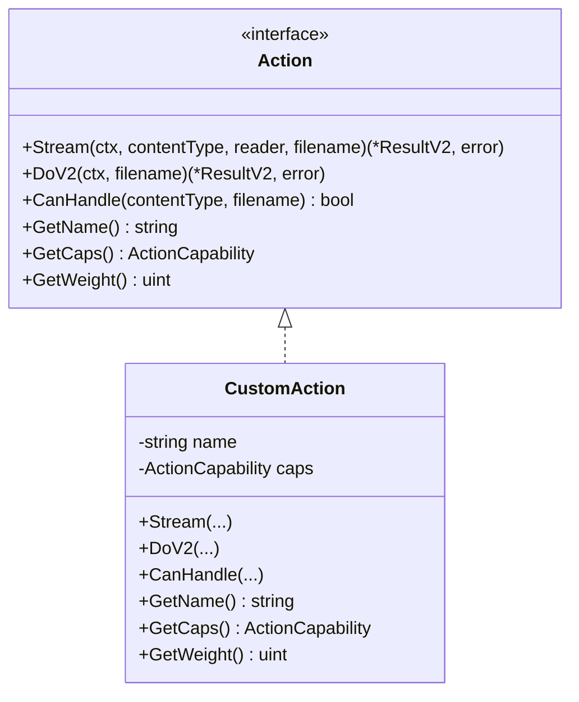

# Go API & Library Usage Guide

This guide describes how to embed and use `indexer` as a Go library within your applications.

---

## Installation

```bash
go get github.com/ocfl-archive/indexer/v3
```

---

## Basic Indexing Example

Initialize the indexer using `pkg/util.InitIndexer` and process an open `io.Reader`:

```go
package main

import (
	"context"
	"fmt"
	"log"
	"os"

	"github.com/je4/utils/v2/pkg/zLogger"
	"github.com/ocfl-archive/indexer/v3/pkg/indexer"
	"github.com/ocfl-archive/indexer/v3/pkg/util"
	"github.com/rs/zerolog"
)

func main() {
	// 1. Create logger
	zl := zerolog.New(os.Stdout).With().Timestamp().Logger()
	var logger zLogger.ZLogger = &zl

	// 2. Prepare configuration
	cfg := &indexer.IndexerConfig{
		Siegfried: indexer.ConfigSiegfried{
			Enabled: true,
		},
		Checksum: indexer.ConfigChecksum{
			Enabled: true,
			Digest:  []string{"sha256", "md5"},
		},
		XML: indexer.ConfigXML{
			Enabled: true,
		},
		JSON: indexer.ConfigJSON{
			Enabled: true,
		},
	}

	// 3. Initialize Indexer
	idx, actions, closer, err := util.InitIndexer(cfg, logger)
	if err != nil {
		log.Fatalf("Failed to initialize indexer: %v", err)
	}
	defer closer.Close()

	// 4. Open file for streaming
	file, err := os.Open("testdata/sample.xml")
	if err != nil {
		log.Fatalf("Failed to open file: %v", err)
	}
	defer file.Close()

	// 5. Execute streaming analysis
	result, err := idx.ActionDispatcher().StreamContext(
		context.Background(),
		file,
		[]string{"sample.xml"},
		actions,
	)
	if err != nil {
		log.Fatalf("Indexing failed: %v", err)
	}

	// 6. Inspect Results
	fmt.Printf("MIME Type: %s\n", result.Mimetype)
	fmt.Printf("PRONOM:    %s\n", result.Pronom)
	fmt.Printf("Type:      %s / Subtype: %s\n", result.Type, result.Subtype)
	fmt.Printf("Checksums: %+v\n", result.Checksum)
}
```

---

## Implementing a Custom Action

You can extend `indexer` with bespoke analyzers by implementing the `indexer.Action` interface:



### Custom Action Implementation

```go
package myactions

import (
	"context"
	"io"
	"strings"

	"github.com/ocfl-archive/indexer/v3/pkg/indexer"
)

type CustomValidator struct {
	name string
}

func NewCustomValidator(name string, ad *indexer.ActionDispatcher) indexer.Action {
	v := &CustomValidator{name: name}
	ad.RegisterAction(v)
	return v
}

func (v *CustomValidator) GetName() string {
	return v.name
}

func (v *CustomValidator) GetCaps() indexer.ActionCapability {
	return indexer.ACTSTREAM | indexer.ACTFILEHEAD
}

func (v *CustomValidator) GetWeight() uint {
	return 20
}

func (v *CustomValidator) CanHandle(contentType, filename string) bool {
	return strings.HasSuffix(filename, ".custom") || contentType == "application/x-custom"
}

func (v *CustomValidator) Stream(ctx context.Context, contentType string, reader io.Reader, filename string) (*indexer.ResultV2, error) {
	result := indexer.NewResultV2()
	result.Type = "custom"
	result.Subtype = "format-v1"
	result.Mimetype = "application/x-custom"
	result.Metadata[v.name] = map[string]any{
		"validated": true,
	}
	return result, nil
}

func (v *CustomValidator) DoV2(ctx context.Context, filename string) (*indexer.ResultV2, error) {
	// Call stream or custom file logic
	return v.Stream(ctx, "", nil, filename)
}
```
