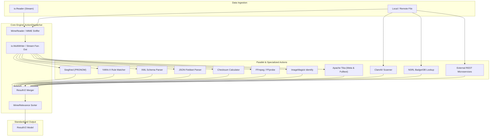
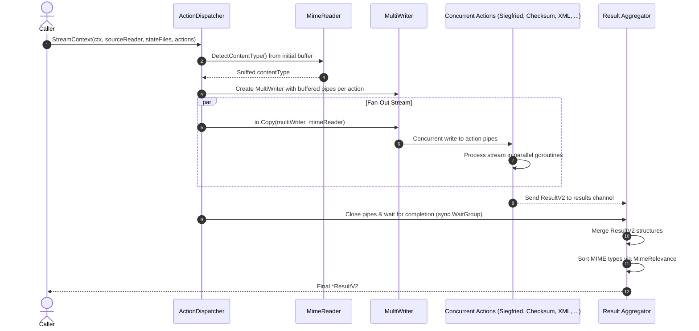
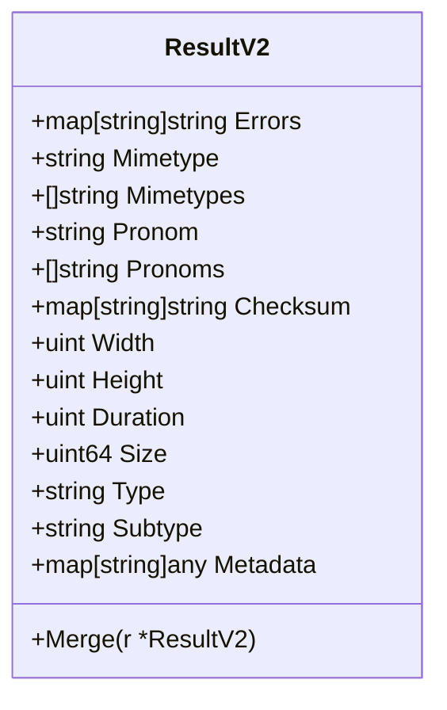

# Indexer Architecture & Design

This document details the internal architecture, lifecycle, streaming execution model, and data aggregation mechanics of the `indexer` engine.

---

## High-Level Overview

`indexer` is a high-performance metadata extraction and format identification engine designed for digital preservation, digital libraries, and archival ingestion workflows (such as OCFL repositories). It runs format identification cascades concurrently over data streams, eliminating redundant I/O passes and maximizing throughput.



---

## Core Components

### 1. `ActionDispatcher`
The central coordinator (`pkg/indexer/actionDispatcher.go`) responsible for:
- Registering and discovering active actions.
- Action capability checking (`ACTFILE`, `ACTSTREAM`, `ACTHEAD`, etc.).
- Multiplexing a single `io.Reader` across all stream-capable actions concurrently using `io.MultiWriter` and `io.Pipe`.
- Aggregating individual action outcomes into a unified `ResultV2` structure.
- Resolving ambiguous MIME types according to configurable priority weights (`MimeRelevance`).

### 2. `Action` Interface
Every identification tool or analyzer implements the standard `Action` interface (`pkg/indexer/action.go`):

```go
type Action interface {
    Stream(ctx context.Context, contentType string, reader io.Reader, filename string) (*ResultV2, error)
    DoV2(ctx context.Context, filename string) (*ResultV2, error)
    CanHandle(contentType string, filename string) bool
    GetName() string
    GetCaps() ActionCapability
    GetWeight() uint
}
```

### 3. Action Capabilities (`ActionCapability`)
Capabilities indicate execution modes supported by an action:
- `ACTFILE`: Requires a local filepath on disk.
- `ACTSTREAM`: Capable of processing data streamed through `io.Reader`.
- `ACTHEAD`: Only requires the file header / initial bytes.
- `ACTHTTP` / `ACTHTTPS`: Can handle remote HTTP(S) resources directly.

---

## Streaming Execution Lifecycle

When `ActionDispatcher.StreamContext()` is invoked, data flows through a non-blocking parallel pipeline:



---

## MIME Relevance & Ambiguity Resolution

Different tools might identify different MIME types for the same payload (e.g. `text/plain` vs `application/xml` vs specialized `application/geo+json`). 

`indexer` resolves this deterministically using the configured `MimeRelevance` table:
1. Each MIME type detected by any action is evaluated against `MimeRelevance` regular expressions.
2. Regexes are evaluated with priority given to higher `weight` values, breaking ties with regex pattern specificity.
3. The MIME type with the highest weight becomes `ResultV2.Mimetype`, while all candidates remain recorded in `ResultV2.Mimetypes`.

```toml
[Indexer.MimeRelevance.1]
regexp = "^application/octet-stream$"
weight = 1 # Highly generic, easily down-ranked

[Indexer.MimeRelevance.2]
regexp = "^text/plain$"
weight = 3

[Indexer.MimeRelevance.7]
regexp = "^.+/x-.+"
weight = 80 # Highly specific vendor/experimental format
```

---

## Result Aggregation (`ResultV2`)

`ResultV2` is the standard data model returned by all operations:



- **`Merge()`**: Intelligently combines slice fields (`Mimetypes`, `Pronoms`) with deduplication (`slices.Compact`), takes the maximum dimensions (`Width`, `Height`, `Duration`, `Size`), and merges errors and nested metadata maps without overwriting unrelated data.
- **`GetMetadata[T](r, key)` / `SetMetadata[T](r, key, val)`**: Generic helper functions for type-safe metadata access.
