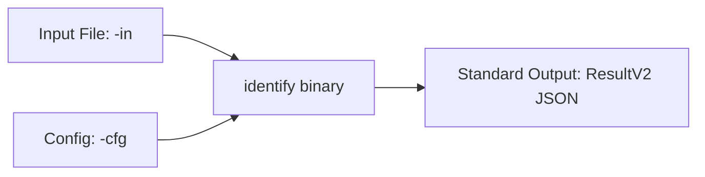

# Command Line Interface (CLI) Guide

This guide covers the command-line binaries bundled with the repository: `identify`, `nsrl2badger`, and `test`.

---

## 1. `identify` CLI

The `identify` tool runs the configured indexer pipeline against an input file and outputs the resulting metadata and format identification JSON.



### Synopsis

```bash
identify -cfg <config-file.toml> -in <input-file>
```

### Flags

| Flag | Type | Description |
|---|---|---|
| `-cfg` | `string` | Path to the TOML configuration file (e.g. `configs/indexer.toml`). |
| `-in` | `string` | Path to the target file to index and identify. |

### Example

```bash
identify -cfg configs/indexer.toml -in /data/archive/sample.tif
```

### Sample Output

```json
{
  "mimetype": "image/tiff",
  "mimetypes": [
    "image/tiff",
    "image/x-tiff"
  ],
  "pronom": "fmt/353",
  "pronoms": [
    "fmt/353"
  ],
  "width": 3840,
  "height": 2160,
  "size": 24883200,
  "type": "image",
  "subtype": "tiff",
  "checksum": {
    "md5": "70d2b450f38b2582845c85b54fa3fb00",
    "sha256": "4b227777d4dd1fc61c6f884f48641d02b4d121d3fd328cb08b5531fcacdabf8a"
  },
  "metadata": {
    "identify": {
      "magick": {
        "format": "TIFF",
        "mimeType": "image/tiff"
      }
    }
  }
}
```

---

## 2. `nsrl2badger` CLI

`nsrl2badger` is an administrative utility that compiles NIST NSRL Reference Data Set (RDS) files from ISO/ZIP distributions into a high-speed BadgerDB key-value store.

### Synopsis

```bash
nsrl2badger -badger <output-db-dir> -in <nsrl-file.zip/iso> [-checkonly]
```

### Flags

| Flag | Type | Description |
|---|---|---|
| `-badger` | `string` | Target directory for the BadgerDB database. |
| `-in` | `string` | Source NSRL RDS distribution archive (`.zip`, `.iso`, or uncompressed). |
| `-checkonly` | `bool` | Validates archive entries without writing records to BadgerDB. |

---

## 3. `test` CLI

The `test` utility provides an interactive / automated test harness for running sample batches against various file format suites and logging execution metrics.

### Synopsis

```bash
test -cfg <config.toml> -in <test-file>
```
