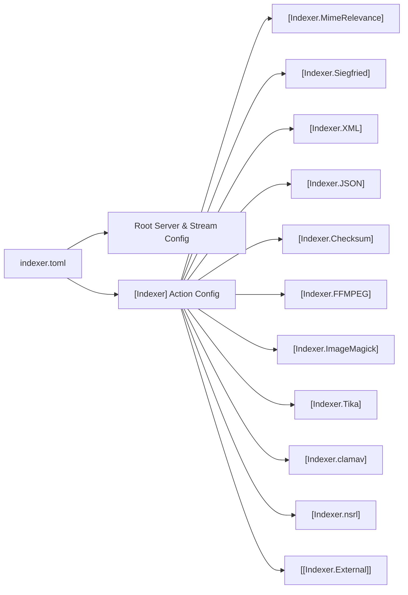

# Configuration Reference

This guide provides a comprehensive reference for the `indexer` configuration file format (`indexer.toml`).

---

## Configuration Overview

The configuration is structured into core server/streaming settings and an `[Indexer]` block defining individual actions and format cascade rules.



---

## Root Options

| Parameter | Type | Default | Description |
|---|---|---|---|
| `headersize` | `int` | `100000` | Number of header bytes buffered for initial sniffing and identification. |
| `headertimeout` | `string` | `"100s"` | Timeout for reading the header stream. |
| `forcedownload` | `string` | `"^image/.*$"` | Regex of MIME types forced to download if remote source cannot be streamed. |
| `maxdownloadsize` | `int64` | `4294967295` | Maximum download size in bytes (4GB default). |
| `tempdir` | `string` | `"/tmp"` | Temporary directory used when streams spill to disk. |
| `logfile` | `string` | `""` | File path for primary application logs (empty logs to stdout). |
| `loglevel` | `string` | `"INFO"` | Log level: `DEBUG`, `INFO`, `NOTICE`, `WARNING`, `ERROR`, `CRITICAL`. |
| `accesslog` | `string` | `""` | File path for HTTP access log. |
| `addr` | `string` | `"localhost:8000"` | Listen address for server mode. |
| `jwtkey` | `string` | `""` | Shared secret key for JWT token verification. |
| `jwtalg` | `[]string` | `["HS256"]` | Allowed JWT signing algorithms. |

---

## Action Configurations

### 1. `[Indexer.MimeRelevance]`
Assigns relative weights to MIME types to resolve ambiguities. Higher weights take precedence when selecting the primary `ResultV2.Mimetype`.

```toml
[Indexer.MimeRelevance.1]
regexp = "^application/octet-stream$"
weight = 1

[Indexer.MimeRelevance.2]
regexp = "^text/plain$"
weight = 3

[Indexer.MimeRelevance.3]
regexp = "^.+/x-.+"
weight = 80
```

---

### 2. `[Indexer.Siegfried]`
Configures PRONOM signature identification.

```toml
[Indexer.Siegfried]
enabled = true
signature = "" # Path to .sig file, or "" to use embedded signature
streamsize = 67108864 # 64MB buffer

[Indexer.Siegfried.MimeMap]
"fmt/134" = "audio/mp3"
"x-fmt/92" = "image/psd"

[Indexer.Siegfried.TypeMap."fmt/483"]
Type = "text"
Subtype = "epub"
```

---

### 3. `[Indexer.XML]`
Configures streaming XML root/namespace matching.

```toml
[Indexer.XML]
enabled = true

[Indexer.XML.Format.mets]
Element = "mets:mets"
Regexp = true
Attributes."xmlns:mets" = "^https?://www.loc.gov/METS/?$"
Type = "metadata"
Subtype = "METS"
Mime = "application/xml"
Pronom = "fmt/917"
```

---

### 4. `[Indexer.JSON]`
Configures JSON schema identification based on required and candidate fields.

```toml
[Indexer.JSON]
enabled = true

[Indexer.JSON.Format.geojson]
mandatoryfields = ["type", "features"]
optionalfields = ["bbox", "crs"]
numoptionals = 0
pronom = "fmt/817"
mime = "application/geo+json"
type = "vector"
subtype = "geojson"
```

---

### 5. `[Indexer.Checksum]`
Configures multi-algorithm checksum calculations.

```toml
[Indexer.Checksum]
enabled = true
digest = ["sha512", "sha256", "md5"]
```

---

### 6. `[Indexer.FFMPEG]`
Configures audio/video metadata extraction with `ffprobe`.

```toml
[Indexer.FFMPEG]
enabled = true
ffprobe = "ffprobe"
wsl = false
timeout = "25s"
online = true

[[Indexer.FFMPEG.Mime]]
video = true
audio = true
format = "mov,mp4,m4a,3gp,3g2,mj2"
mime = "video/mp4"
```

---

### 7. `[Indexer.ImageMagick]`
Configures image metadata, frame inspection, and geometry extraction.

```toml
[Indexer.ImageMagick]
enabled = true
identify = "identify"
convert = "convert"
wsl = false
timeout = "480s"
online = true
```

---

### 8. `[Indexer.Tika]`
Configures Apache Tika metadata and full-text extraction endpoints.

```toml
[Indexer.Tika]
enabled = true
online = true
timeout = "15s"
addressmeta = "http://localhost:9998/rmeta/text"
addressfulltext = "http://localhost:9998/tika"
regexpmimemeta = "^."
regexpmimemetanot = "^(audio|video|image)/"
regexpmimefulltext = "^(application/pdf|text/)"
regexpmimefulltextnot = "^(audio|video|image)/"
```

---

### 9. `[Indexer.clamav]`
Configures ClamAV antivirus scanning.

```toml
[Indexer.clamav]
enabled = true
clamscan = "/usr/bin/clamdscan"
wsl = false
timeout = "15s"
```

---

### 10. `[Indexer.nsrl]`
Configures NIST NSRL hash lookup using BadgerDB.

```toml
[Indexer.nsrl]
enabled = false
badger = "/var/data/indexer/nsrl_badger"
```

---

### 11. `[[Indexer.External]]`
Registers external microservices or webhooks.

```toml
[[Indexer.External]]
name = "validateimage"
address = "http://localhost:8083/validateimage/[[PATH]]"
calltype = "EACTURL"
mimetype = "^image/.*"
ActionCapabilities = ["ACTFILE"]
```

---

## Minimal Working Example (`minimal.toml`)

```toml
[Indexer]
[Indexer.Siegfried]
enabled = true
signature = ""

[Indexer.Checksum]
enabled = true
digest = ["sha256", "md5"]

[Indexer.XML]
enabled = true

[Indexer.JSON]
enabled = true
```
